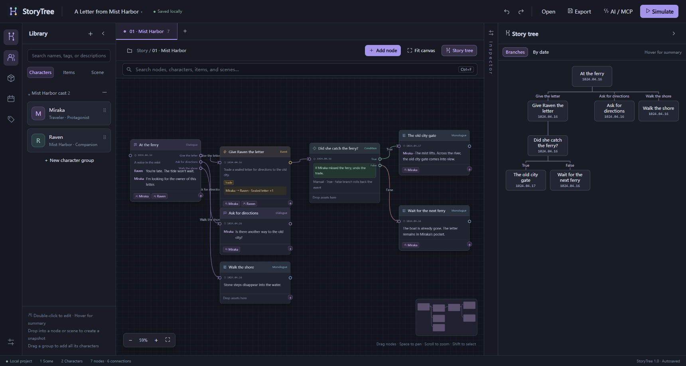

# StoryTree 1.2.0

StoryTree is a portable Windows editor for branching game scripts. Write scenes on a node canvas, reuse character and item cards, and simulate how choices and events change a route.

The canvas and inspector take inspiration from Arrow 3.1.

**[Download for Windows x64](https://github.com/zlep123/StoryTree/releases/download/v1.2.0/StoryTree-1.2.0-win-x64.zip)** · [Release notes and checksums](https://github.com/zlep123/StoryTree/releases/tag/v1.2.0) · [Two-minute bilingual demo](https://github.com/zlep123/StoryTree/releases/download/v1.2.0/StoryTree-1.2.0-Demo-ZH-EN.mp4) · [中文说明](docs/README.zh-CN.md)



## Get started

1. Extract the ZIP to a writable folder and launch `StoryTree.exe`. The first launch opens *A Letter from Mist Harbor*. Use the project menu to start a blank story or **Open** to load a `.storytree.json` project.
2. Right-click the canvas to add a dialogue, monologue, condition, jump, event, or label node. Connect an output on the right of one node to the input on the left of the next. Select a node to edit its text, date, and location.
3. Drag characters and items from the library into nodes. Use **Simulate** to follow a branch, test player input, and see pending changes to skills, attributes, or inventory.
4. Open **Story Tree** to read branches and connected story excerpts, or create a segmented outline with date and location ranges and links to story assets.
5. Use **Settings** to switch between Simplified Chinese and English or check for updates. **Save** commits pending edits. **Export** produces a portable project file with its images.

## Edit a project

- **Dialogue** supports ordered turn-taking, same-speaker continuation, and per-line rules. Use **Expand** beside a line or **Edit dialogue log** to edit a node's dialogue together. **Node log** can also export a UTF-8 text report.
- **Find** and **Replace** have separate controls in the node inspector, expanded dialogue editor, and outline editor. Use Ctrl+F or Ctrl+H within a text field. The **Replace** button beside project search previews changes across nodes in the current scene or all scenes. Select the fields to update, then apply the batch. Character variable links are preserved.
- **Scene map** lets you position locations, characters, and geometric or image objects. Drag on empty space to select a group and hold Shift to add to it. Open **Map layers** to hide or lock the background, locations and routes, characters, or objects. Layer preferences are local to the installation.
- **Import Script** previews nodes from a TXT script with headings and speaker lines. Missing dates can stay undated. **Import Excel** imports character and item cards from an XLSX workbook. Start with the [Excel template](examples/Excel-Import-Template.xlsx) or [script sample](examples/Mist-Harbor-Script.txt).

## Build a plugin

StoryTree 1.2.0 uses **Plugin API 1**. Open **Plugins → Install or update plugin**, select the [Scene Counter example](examples/scene-count.storytree-plugin.json), then enable and run it. To develop your own package, define its ID, version, permissions, actions, and a JavaScript `source` string that calls `StoryTree.register`. Packages can update independently of the app. See the [English quick start](docs/PLUGINS.en.md) or [中文 API 参考](docs/PLUGINS.md).

## Connect an AI agent

The **AI / MCP** menu supplies a configuration using your actual installation path. `StoryTree.MCP.exe` is a local stdio MCP server. Its tools can read and edit the current project, connect nodes, simulate routes, and inspect the story timeline. Read `storytree://schema` for the project model and commands.

Example Codex configuration:

```toml
[mcp_servers.storytree]
command = 'C:\Apps\StoryTree\StoryTree.MCP.exe'
args = []
```

## Project files and upgrades

StoryTree saves the working project in `data/story.storytree.json` next to the executable. Backups and shared media live under `data/backups` and `data/media`. To move an installation, close the app and copy its entire `data` directory, or export a standalone project and open it in the destination installation.

## Build from source

Use Windows x64, Node.js 22.12 or later, and the Windows .NET Framework C# compiler.

```powershell
npm ci
npm test
npm start
npm run build
```

The build writes a portable folder to `dist/StoryTree-1.2.0-win-x64`. Pass an empty output directory with `npm run build -- <directory>`.
